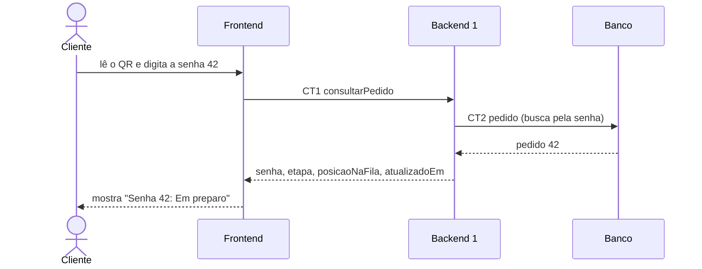

# Fluxo do E1: Chegada ao pedido pela senha

**Feito quando (da Entrega 1):** O cliente aponta a câmera do celular para o QR impresso, o navegador abre a tela de senha, ele digita "42" e vê o número da senha e a etapa atual escrita por extenso. Senha que não existe mostra "Pedido não encontrado, confira o número na sua senha".

## Passos

1. O cliente aponta a câmera do celular para o QR impresso, e o navegador abre a tela de senha do Frontend.
2. O cliente digita a senha 42.
3. O Frontend chama o Backend 1 com a operação consultarPedido (CT1).
4. O Backend 1 busca o pedido de senha 42 na tabela pedido (CT2).
5. O Backend 1 responde ao Frontend com a senha, a etapa, a posição na fila (quando o pedido ainda está na fila) e a data e hora da última mudança.
6. O Frontend mostra a senha 42 e a etapa escrita por extenso (por exemplo, "Em preparo").

Se a senha não existe, o Backend 1 devolve o erro PEDIDO_NAO_ENCONTRADO (CT1), e o Frontend mostra "Pedido não encontrado, confira o número na sua senha".

## Diagrama

**Contratos usados:** CT1 consultarPedido, CT2 pedido.
