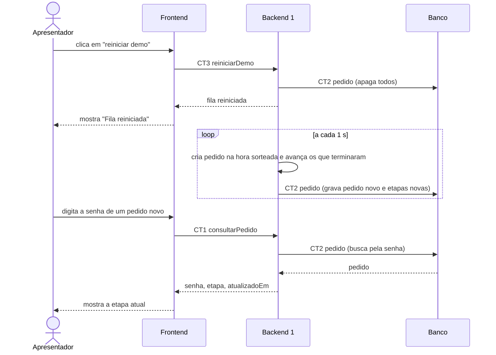

# Fluxo do E2: Fila de demonstração

**Feito quando (da Entrega 1):** Com o sistema no ar e ninguém mexendo, a cada 30 s entra um pedido novo com senha própria e os existentes avançam de etapa sozinhos até "Encerrado". O botão "reiniciar demo" esvazia a fila.

**Como roda hoje (novembro de 2026, [ADR 0002](https://github.com/pedromeira220/pi4-0102-g6-backend-1/blob/main/docs/adr/0002-simular-a-cozinha-por-cozinheiros.md)):** os pedidos chegam em intervalos sorteados de 20 a 30 s (10 a 20 s no horário de pico, CT8) e a cozinha tem 3 cozinheiros. Cada pedido espera em recebido até sobrar um cozinheiro, fica em preparo pelo tempo da sua comanda, passa a pronto e é encerrado 15 s depois. Os passos 5 e 6 abaixo descrevem esse ciclo.

## Passos

1. O apresentador abre a página `/demo` do Frontend e clica em "reiniciar demo".
2. O Frontend chama o Backend 1 com a operação reiniciarDemo (CT3).
3. O Backend 1 apaga todos os pedidos da tabela pedido (CT2) e responde ao Frontend.
4. O Frontend mostra "Fila reiniciada".
5. A cada 1 s, o simulador do Backend 1 confere o relógio. Quando chega a hora sorteada, cria um pedido novo, com a senha seguinte, na etapa recebido, e grava na tabela pedido (CT2).
6. No mesmo ciclo, o simulador encerra os prontos há mais de 15 s, passa a pronto os que terminaram o preparo, e põe em preparo os primeiros da fila enquanto houver cozinheiro livre. Grava cada etapa nova na tabela pedido (CT2).
7. O apresentador digita a senha de um dos pedidos novos na tela de senha, e o Frontend busca o pedido com consultarPedido (CT1).
8. O Frontend mostra a etapa atual daquele pedido.

## Diagrama

**Contratos usados:** CT1 consultarPedido, CT2 pedido, CT3 reiniciarDemo.
