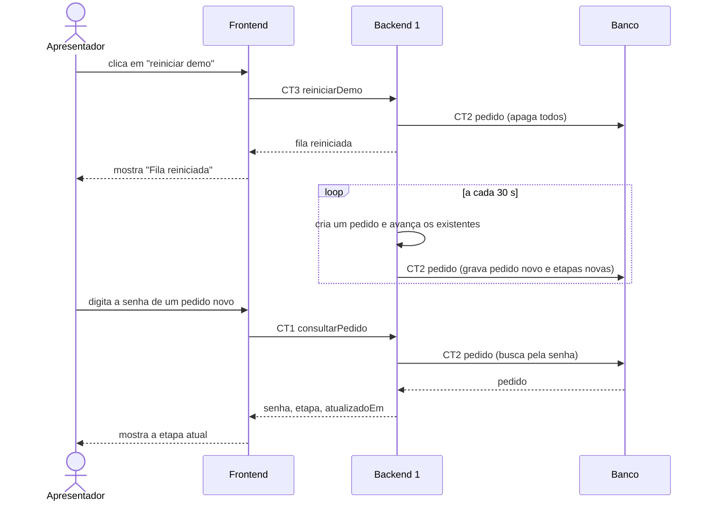

# Fluxo do E2: Fila de demonstração

**Feito quando (da Entrega 1):** Com o sistema no ar e ninguém mexendo, a cada 30 s entra um pedido novo com senha própria e os existentes avançam de etapa sozinhos até "Encerrado". O botão "reiniciar demo" esvazia a fila.

## Passos

1. O apresentador abre a página `/demo` do Frontend e clica em "reiniciar demo".
2. O Frontend chama o Backend 1 com a operação reiniciarDemo (CT3).
3. O Backend 1 apaga todos os pedidos da tabela pedido (CT2) e responde ao Frontend.
4. O Frontend mostra "Fila reiniciada".
5. A cada 30 s, o simulador do Backend 1 cria um pedido novo, com senha própria, na etapa recebido, e grava na tabela pedido (CT2).
6. No mesmo ciclo, o simulador avança cada pedido existente uma etapa (recebido, em_preparo, pronto, encerrado) e grava a etapa nova na tabela pedido (CT2).
7. O apresentador digita a senha de um dos pedidos novos na tela de senha, e o Frontend busca o pedido com consultarPedido (CT1).
8. O Frontend mostra a etapa atual daquele pedido.

## Diagrama

**Contratos usados:** CT1 consultarPedido, CT2 pedido, CT3 reiniciarDemo.
