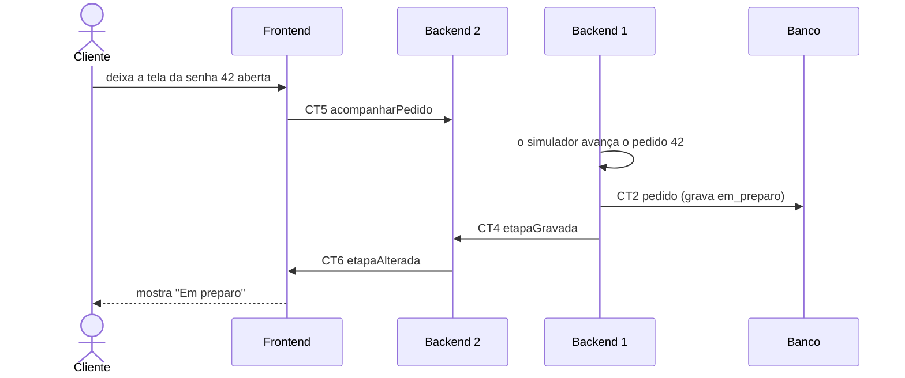

# Fluxo do E3: A tela se atualiza sozinha

**Feito quando (da Entrega 1):** Com a tela aberta na senha "42" e o cliente sem tocar em nada, a etapa muda na tela em até 10 s depois que a fila avança aquele pedido.

## Passos

1. O cliente está com a tela da senha 42 aberta, depois do fluxo E1.
2. O Frontend se inscreve no canal do pedido 42 no Backend 2 com a operação acompanharPedido (CT5).
3. O simulador do Backend 1 avança o pedido 42 de recebido para em_preparo.
4. O Backend 1 grava a etapa nova na tabela pedido (CT2).
5. O Backend 1 envia a mensagem etapaGravada (CT4) ao Backend 2 pelo Socket.
6. O Backend 2 repassa a mensagem etapaAlterada (CT6) para as páginas inscritas no canal do pedido 42.
7. O Frontend troca a etapa na tela, sem o cliente tocar em nada.

## Diagrama

**Contratos usados:** CT2 pedido, CT4 etapaGravada, CT5 acompanharPedido, CT6 etapaAlterada.
