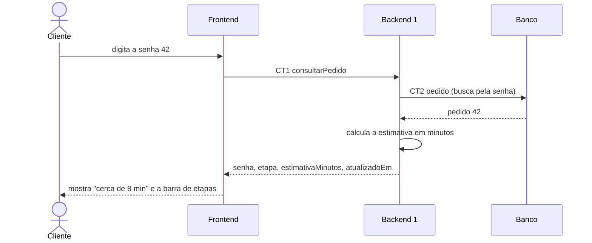

# Fluxo do E4: Quanto falta na tela

**Feito quando (da Entrega 1):** Além da etapa, a tela mostra "cerca de 8 min" e uma barra com Recebido, Em preparo e Pronto, com a atual destacada e as anteriores marcadas como cumpridas. Em "Pronto", mostra "pode retirar" no lugar do número.

## Passos

1. O cliente digita a senha 42 na tela de senha.
2. O Frontend chama o Backend 1 com a operação consultarPedido (CT1).
3. O Backend 1 busca o pedido de senha 42 na tabela pedido (CT2).
4. O Backend 1 calcula quantos minutos faltam a partir da etapa atual e da hora da última mudança.
5. O Backend 1 responde ao Frontend com a etapa e a estimativa em minutos.
6. O Frontend mostra "cerca de 8 min" e a barra Recebido, Em preparo e Pronto, com a etapa atual destacada e as anteriores marcadas como cumpridas.
7. Quando a etapa é pronto, a resposta vem sem estimativa, e o Frontend mostra "pode retirar" no lugar do número.

## Diagrama

**Contratos usados:** CT1 consultarPedido, CT2 pedido.
