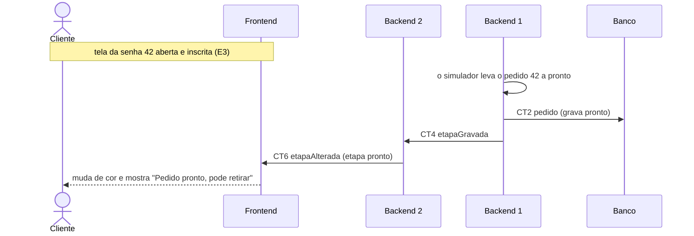

# Fluxo do E5: Aviso de pronto

**Feito quando (da Entrega 1):** Quando a fila leva o pedido a "Pronto", a tela aberta muda de cor e mostra "Pedido pronto, pode retirar". O aviso fica visível até o pedido ser encerrado.

## Passos

1. O cliente está com a tela da senha 42 aberta e inscrita no canal do pedido (fluxo E3).
2. O simulador do Backend 1 avança o pedido 42 de em_preparo para pronto.
3. O Backend 1 grava a etapa nova na tabela pedido (CT2).
4. O Backend 1 envia a mensagem etapaGravada (CT4) ao Backend 2 pelo Socket.
5. O Backend 2 repassa a mensagem etapaAlterada (CT6), com a etapa pronto, para as páginas inscritas no canal do pedido 42.
6. O Frontend muda a cor da tela e mostra "Pedido pronto, pode retirar".
7. O aviso continua na tela até chegar uma etapaAlterada (CT6) com a etapa encerrado.

## Diagrama

**Contratos usados:** CT2 pedido, CT4 etapaGravada, CT6 etapaAlterada.
