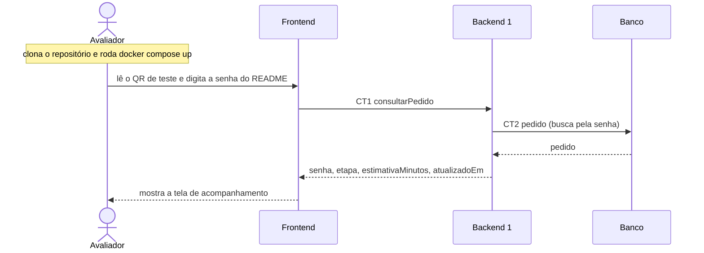

# Fluxo do E6: Sistema empacotado

**Feito quando (da Entrega 1):** Num clone limpo do repositório, docker compose up sobe o sistema. O README diz a URL, onde está o QR de teste e qual senha usar. Quem nunca viu o projeto chega à tela de acompanhamento em menos de 5 minutos.

## Passos

1. O avaliador clona o repositório e roda `docker compose up`.
2. O Docker Compose sobe o Banco, o Backend 1, o Backend 2 e o Frontend.
3. O avaliador abre o README, que diz a URL, onde está o QR de teste e qual senha usar.
4. O avaliador lê o QR de teste com o celular e digita a senha indicada no README.
5. O Frontend chama o Backend 1 com a operação consultarPedido (CT1).
6. O Backend 1 busca o pedido na tabela pedido (CT2) e responde ao Frontend.
7. O Frontend mostra a tela de acompanhamento do pedido.

## Diagrama

**Contratos usados:** CT1 consultarPedido, CT2 pedido.
