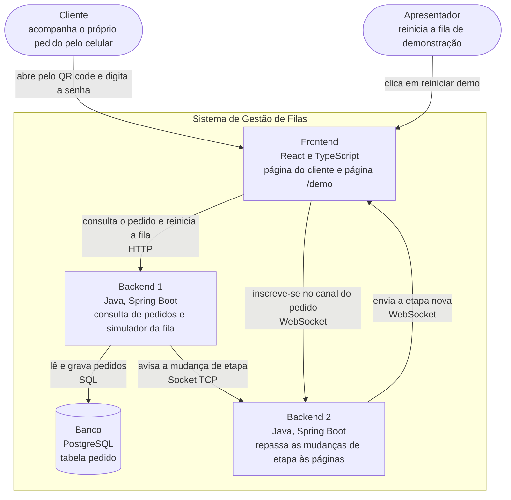

# Visão geral

Sistema de acompanhamento de pedidos para praças de alimentação. O cliente abre a página pelo QR code, digita a senha do pedido e acompanha a etapa, a estimativa de tempo e a posição na fila, que se atualizam sozinhas.

Os fluxos cobrem os entregáveis E1 a E6 da tabela de escopo. Um acréscimo desde a Entrega 1: o E4 passa a mostrar também a posição do pedido na fila.

## Módulos

| Módulo | O que faz | Tecnologia | Repositório | Responsável |
|---|---|---|---|---|
| Frontend | Página do cliente (senha, etapa, estimativa, posição na fila e aviso de pronto) e página `/demo`, que reinicia a fila de demonstração | React e TypeScript | pi4-0102-g6-frontend | Neilton e Pedro |
| Backend 1 | Responde às consultas de pedido por HTTP, roda o simulador da fila de demonstração e calcula a posição de cada pedido na fila e avisa o Backend 2 a cada mudança de etapa ou de posição | Java (Spring Boot) | pi4-0102-g6-backend-1 | Murilo e João |
| Backend 2 | Recebe os avisos do Backend 1 por Socket, no molde do Fazedor de Continhas, e os repassa às páginas abertas por WebSocket | Java (Spring Boot e `java.net.Socket`) | pi4-0102-g6-backend-2 | Patrick e Pedro |
| Banco | Guarda os pedidos | PostgreSQL | junto do Backend 1 | Pedro |

O sistema não usa serviço externo.

## Diagrama de contêineres

## Convenção de nomes

Nas mensagens entre módulos usamos camelCase (`senha`, `estimativaMinutos`, `posicaoNaFila`, `atualizadoEm`). No banco usamos snake_case (`criado_em`, `atualizado_em`). Nome de operação é verbo no infinitivo mais o objeto (`consultarPedido`, `reiniciarDemo`, `acompanharPedido`). Nome de mensagem de aviso é o objeto mais o que aconteceu (`etapaGravada`, `etapaAlterada`).

## Fluxos

- [E1: Chegada ao pedido pela senha](E1-chegada-ao-pedido-pela-senha.md)
- [E2: Fila de demonstração](E2-fila-de-demonstracao.md)
- [E3: A tela se atualiza sozinha](E3-tela-se-atualiza-sozinha.md)
- [E4: Quanto falta na tela](E4-quanto-falta-na-tela.md)
- [E5: Aviso de pronto](E5-aviso-de-pronto.md)
- [E6: Sistema empacotado](E6-sistema-empacotado.md)

## Contratos

| ID | Nome | Fronteira | Repositório |
|---|---|---|---|
| CT1 | [consultarPedido](https://github.com/pedromeira220/pi4-0102-g6-backend-1/blob/main/docs/contratos/CT1-consultarPedido.md) | HTTP | pi4-0102-g6-backend-1 |
| CT2 | [pedido](https://github.com/pedromeira220/pi4-0102-g6-backend-1/blob/main/docs/contratos/CT2-pedido.md) | Banco | pi4-0102-g6-backend-1 |
| CT3 | [reiniciarDemo](https://github.com/pedromeira220/pi4-0102-g6-backend-1/blob/main/docs/contratos/CT3-reiniciarDemo.md) | HTTP | pi4-0102-g6-backend-1 |
| CT4 | [etapaGravada](https://github.com/pedromeira220/pi4-0102-g6-backend-1/blob/main/docs/contratos/CT4-etapaGravada.md) | Socket TCP | pi4-0102-g6-backend-1 |
| CT5 | [acompanharPedido](https://github.com/pedromeira220/pi4-0102-g6-backend-2/blob/main/docs/contratos/CT5-acompanharPedido.md) | WebSocket | pi4-0102-g6-backend-2 |
| CT6 | [etapaAlterada](https://github.com/pedromeira220/pi4-0102-g6-backend-2/blob/main/docs/contratos/CT6-etapaAlterada.md) | WebSocket | pi4-0102-g6-backend-2 |
